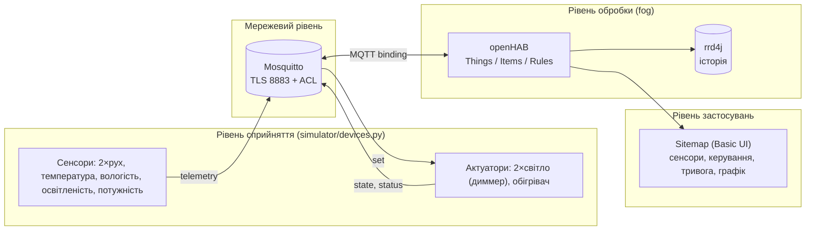
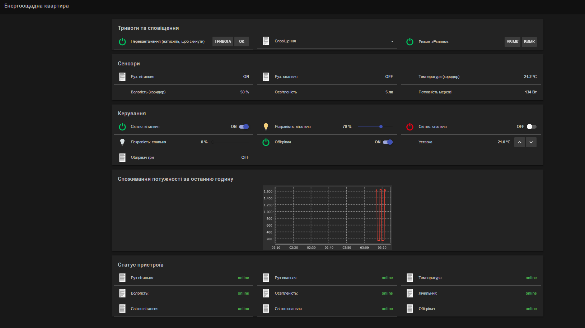
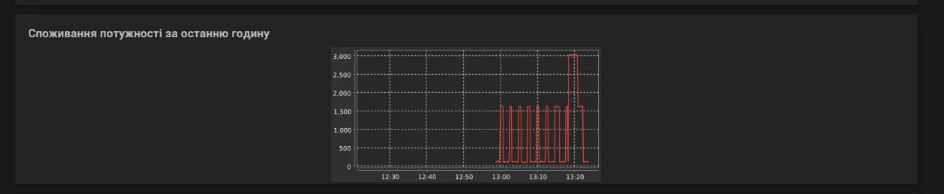
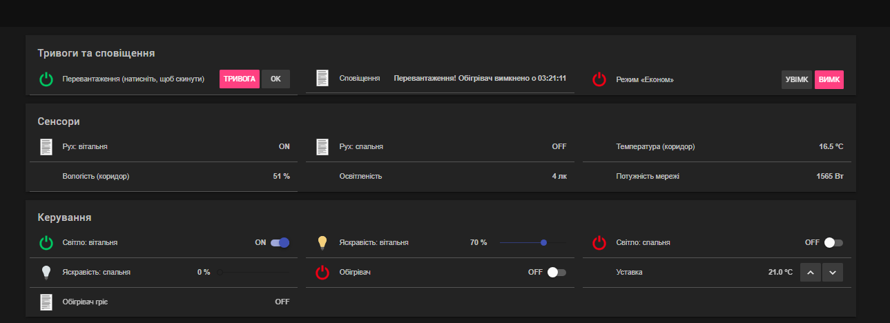
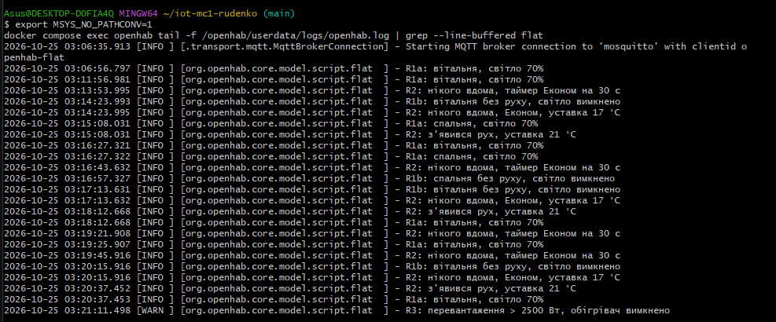
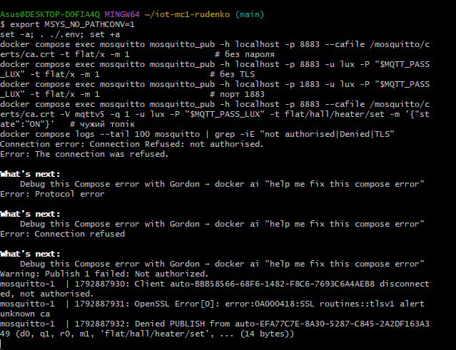

# Енергоощадна розумна квартира (Модульний контроль 1, варіант 1)
Руденко Олексій,Ік-42

## 1. Опис системи
Квартира з двох кімнат (вітальня, спальня) і коридору. Система вимикає зайве світло,
знижує обігрів, коли нікого немає, і стежить за перевантаженням мережі.
Стек: Python-симулятори (`paho-mqtt`) → Mosquitto (TLS 8883, автентифікація, ACL) → openHAB (Things/Items/Rules, Sitemap, rrd4j).

## 2. Архітектура (чотири рівні)


### Де обробляються дані (edge / fog / хмара)
| Рівень | Що тут виконується |
|---|---|
| **Edge** | Сам пристрій: термостат обігрівача з гістерезисом ±0,3 °C, Last Will, формування JSON. Працює, навіть якщо openHAB недоступний. |
| **Fog** | Локальний сервер у квартирі: Mosquitto + openHAB — усі правила автоматизації, графіки, сповіщення. |
| **Хмара** | Не використовується свідомо: дані про присутність людей приватні, правилам потрібна мала затримка, система має працювати без інтернету. |

## 3. Пристрої
| Пристрій | Тип | MQTT-користувач | Топіки (`flat/<zone>/<device>/…`) |
|---|---|---|---|
| Рух, вітальня | сенсор | `motion_livingroom` | `livingroom/motion` |
| Рух, спальня | сенсор | `motion_bedroom` | `bedroom/motion` |
| Температура (°C) | сенсор | `temperature` | `hall/temperature` |
| Вологість (%) | сенсор | `humidity` | `hall/humidity` |
| Освітленість (лк) | сенсор | `lux` | `hall/lux` |
| Лічильник потужності (Вт) | сенсор | `power` | `main/power` |
| Світло вітальня 0–100 % | актуатор | `light_livingroom` | `livingroom/light` |
| Світло спальня 0–100 % | актуатор | `light_bedroom` | `bedroom/light` |
| Обігрівач ON/OFF + уставка | актуатор | `heater` | `hall/heater` |

## 4. MQTT: топіки та формат
| Топік | Напрям | Приклад payload | QoS | retain |
|---|---|---|---|---|
| `flat/<zone>/<device>/telemetry` | сенсор → брокер | `{"value": 23.4, "unit": "C", "ts": 1761300000}` | 0 | ні |
| `flat/<zone>/<device>/set` | openHAB → актуатор | світло: `{"state":"ON"}` / `{"brightness":70}`; обігрівач: `{"state":"OFF"}` / `{"setpoint":17}` | 1 | ні |
| `flat/<zone>/<device>/state` | актуатор → брокер | `{"state":"ON","brightness":70,"ts":…}` | 1 | **так** |
| `flat/<zone>/<device>/status` | пристрій → брокер | `online` / `offline` (Last Will) | 1 | **так** |

**Обґрунтування QoS.**
- *Телеметрія — QoS 0:* заміри надходять кожні 5 с, втрата одного нічого не ламає, наступний прийде за мить; QoS 1/2 лише додали б трафік і затримку.
- *Команди — QoS 1:* команда «вимкнути обігрівач» не повинна загубитись; допустимий дубль, бо команди ідемпотентні. QoS 2 надлишковий.
- *state/status — QoS 1 + retain:* новий підписник (перезапущений openHAB) одразу бачить поточний стан і доступність пристрою.

**Last Will:** кожен пристрій при підключенні задає Will `offline` (retain) на свій `status` і одразу публікує `online` (retain). При аварійному завершенні процесу брокер сам розсилає `offline`; openHAB бачить це через `availabilityTopic` (Thing → OFFLINE) та item `Status_*`.

## 5. Правила автоматизації (`openhab/conf/rules/flat.rules`)
| № | Умова | Дія |
|---|---|---|
| 1 | Рух і освітленість < 50 лк | Світло 70 % у кімнаті з рухом |
| 1 | Немає руху (таймер на кімнату) | Світло вимкнути |
| 2 | Нікого вдома | Режим «Економ», уставка 17 °C |
| 2 | З'явився рух | Режим «Економ» вимк., уставка 21 °C |
| 3 | Потужність > 2500 Вт протягом таймера | Сповіщення в UI (`Alarm_Overload`, `Alert_Text`) + вимкнення обігрівача |

Тривога перевантаження «залипає» до скидання користувачем (кнопка OK у Sitemap).

**Прискорення для демонстрації.** За завданням інтервали 5 хв / 30 хв / 1 хв. На початку `flat.rules` вони задані трьома константами,
зараз стоять демо-значення по **30 с**:
`NO_MOTION_SEC = 30`, `EMPTY_HOME_SEC = 30`, `OVERLOAD_SEC = 30`.
Бойові значення: `300`, `1800`, `60`. Після зміни файлу виконайте `docker compose restart openhab`.

## 6. Запуск
Потрібні Docker (Compose v2) та openssl. На Windows команди виконуйте в **Git Bash** або **WSL**.
```bash
./scripts/init.sh        # 1) .env з випадковими паролями, сертифікати, passwd брокера, broker.things
docker compose up -d     # 2) брокер + openHAB + симулятор
```
Перший старт openHAB ~2–4 хв. UI: <http://localhost:8080/basicui/app?sitemap=flat>
(при першому вході openHAB просить створити адміністратора — це лише для веб-інтерфейсу).
Після змін у `openhab/conf/` на Windows виконайте `docker compose restart openhab`.

### Сценарії симулятора (кожен спрацьовує одне правило)
```bash
SCENARIO=lights   docker compose up -d --force-recreate simulator   # правило 1: темно + рух у вітальні
SCENARIO=overload docker compose up -d --force-recreate simulator   # правило 3: +1400 Вт до обігрівача > 2500 Вт
SCENARIO=eco      docker compose up -d --force-recreate simulator   # правило 2: нікого вдома, через 90 с хтось повертається
SCENARIO=normal   docker compose up -d --force-recreate simulator   # звичайний день
docker compose logs -f simulator
```
Лог правил openHAB:
```bash
export MSYS_NO_PATHCONV=1
docker compose exec openhab tail -f /openhab/userdata/logs/openhab.log | grep --line-buffered flat
```
Аварійне завершення симулятора (спрацює Last Will, статуси стануть `offline`):
```bash
docker compose kill -s KILL simulator
```

## 7. Безпека
- `allow_anonymous false`; **11 окремих користувачів**: 9 пристроїв, `openhab`, `admin`.
- **ACL** (`mosquitto/config/acl`): сенсор пише лише свої `telemetry`/`status`; актуатор читає лише свій `set` і пише свої `state`/`status`; openHAB читає телеметрію/стани й пише тільки `…/set`.
- **TLS 8883** з власним CA (`certs/generate.sh`). Порт 1883 не відкривається (в `mosquitto.conf` єдиний listener — 8883).
- **Секрети:** паролі лише в `.env` (у git — `.env.example`), ключі та сертифікати в `.gitignore`; `passwd` і `broker.things` генеруються `scripts/init.sh`.
- openHAB довіряє сертифікату брокера через certificate pinning (власний CA не входить до truststore JVM).
- Обмеження: `max_connections 50`, `message_size_limit 4096`. Рівень `debug` у логах увімкнено лише для демонстрації відмов ACL.

### Перевірка відмов
```bash
export MSYS_NO_PATHCONV=1
set -a; . ./.env; set +a
docker compose exec mosquitto mosquitto_pub -h localhost -p 8883 --cafile /mosquitto/certs/ca.crt -t flat/x -m 1                 # без пароля
docker compose exec mosquitto mosquitto_pub -h localhost -p 8883 -u lux -P "$MQTT_PASS_LUX" -t flat/x -m 1                      # без TLS
docker compose exec mosquitto mosquitto_pub -h localhost -p 1883 -u lux -P "$MQTT_PASS_LUX" -t flat/x -m 1                      # порт 1883
docker compose exec mosquitto mosquitto_pub -h localhost -p 8883 --cafile /mosquitto/certs/ca.crt -V mqttv5 -q 1 -u lux -P "$MQTT_PASS_LUX" -t flat/hall/heater/set -m '{"state":"ON"}'   # чужий топік
docker compose logs --tail 100 mosquitto | grep -iE "not authorised|Denied|TLS"
```

### Модель загроз STRIDE
| # | Категорія | Загроза | Протидія |
|---|---|---|---|
| 1 | **S**poofing | Підроблений сенсор публікує фальшиві заміри або видає себе за актуатор | Окремий логін/пароль на пристрій, TLS із перевіркою сертифіката, ACL обмежує, що саме може писати цей логін |
| 2 | **T**ampering | Зміна команд/даних у мережі (наприклад, фальшива потужність, щоб вимкнути обігрівач) | TLS 8883 (шифрування й цілісність); писати в `…/set` може лише `openhab` |
| 3 | **R**epudiation | Неможливо довести, хто надіслав команду | Унікальний користувач на кожного клієнта, `connection_messages` у логах брокера, логи правил openHAB (`logInfo`). Обмеження: окремого захищеного аудиту немає |
| 4 | **I**nformation disclosure | Перехоплення трафіку (присутність людей — чутливі дані); витік паролів із репозиторію | TLS; `.env` та ключі поза git; `.env.example` без секретів |
| 5 | **D**enial of service | Флуд брокера підключеннями або великими повідомленнями | `max_connections`, `message_size_limit`; Last Will + статус показують зникнення пристрою; `restart: unless-stopped` |
| 6 | **E**levation of privilege | Скомпрометований сенсор намагається керувати обігрівачем/світлом | ACL за найменшими привілеями: сенсор не має права писати в чужі топіки (перевіряється в розділі 6 відео) |

## 8. Чому MQTT, а не CoAP, HTTP, Zigbee чи LoRaWAN
Для квартири з невеликою кількістю пристроїв, що публікують дані часто, а команди отримують від центрального контролера, найзручніша модель publish/subscribe: брокер розв'язує пристрої між собою, а retain і Last Will безкоштовно дають «поточний стан» та «пристрій зник». HTTP вимагав би опитування або вебхуків і важчий для постійно увімкнених пристроїв; CoAP (UDP) зручний для обмежених пристроїв, але має слабшу підтримку в openHAB і не має готових retain/LWT-механізмів; Zigbee — це радіорівень, що потребує окремих пристроїв і координатора, тоді як тут усе програмне (із Zigbee-шлюзом MQTT поєднується просто); LoRaWAN розрахований на дальність і мізерні обсяги даних, а не на секундні заміри й швидке керування в межах квартири.

## 9. Скріншоти
| Файл | Що показує |
|---|---|
|  | Sitemap зі всіма сенсорами, керуванням і статусами |
|  | Графік потужності за годину |
|  | Тривога перевантаження мережі |
|  | Лог спрацювання правил R1, R2, R3 |
|  | Відмови автентифікації та ACL у логах брокера |

## 10. Структура репозиторію
```
├── README.md, AI_USAGE.md, docker-compose.yml, .env.example, .gitignore, .gitattributes
├── mosquitto/config/   mosquitto.conf, acl   (passwd генерується)
├── certs/generate.sh   (ключі не в git)
├── scripts/init.sh
├── openhab/conf/       things, items, rules, sitemaps, services, persistence
├── simulator/          devices.py, Dockerfile, requirements.txt
└── docs/screenshots/
```